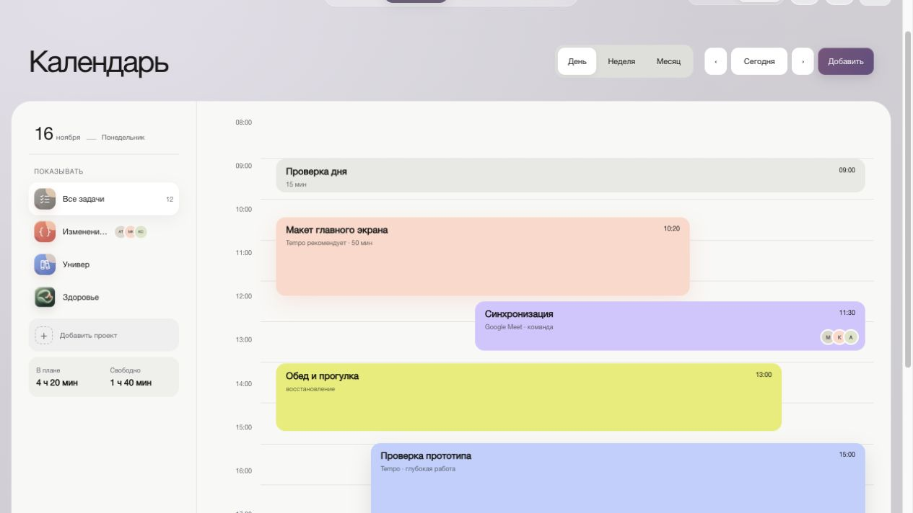
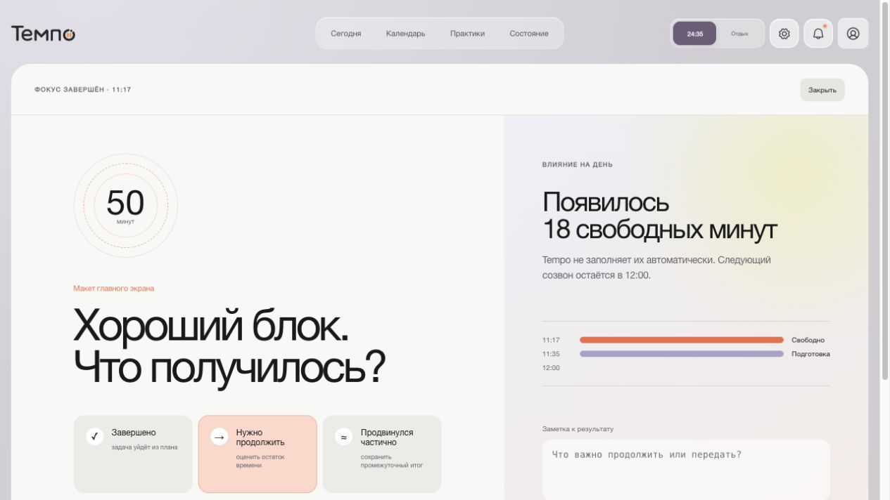
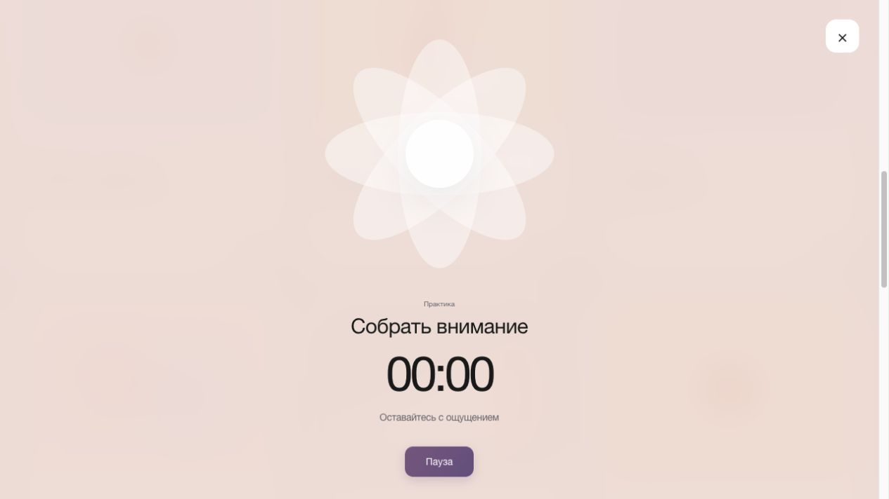

# Tempo — аудит сценариев веб-версии

17 ноября, следующий этап задач: добавлено локальное хранилище `tempo-tasks-v1`, единое для дня, недели и месяца. Создание, изменение даты/времени/заметки/проекта и удаление сохраняются после перезагрузки. Демонстрационные события создаются один раз, пустое хранилище не засеивается заново. Ошибка записи оставляет форму открытой. Проверены браузером создание → перезагрузка → открытие из недели → перенос → месяц → повторная перезагрузка. 10 тестов check-in и хранилища проходят. Сводки Today, нагрузка и проектные списки ещё не подключены к хранилищу; это не полное закрытие пунктов 2 и 12.

17 ноября, этап задач: реализованы создание задачи в дневном календаре, изменение начала/окончания/длительности и заметки, повторное открытие и отмена. Проверено в браузере. Пока данные только в текущей сессии; неделя, месяц, сводки, проектные списки, участники, ссылки и изменение проекта ещё не синхронизированы. Проверка пересечений не реализована; повторение отключено и ограничение явно указано в форме. Пункт 2 закрыт частично.

Обновление 17 ноября: первый этап пункта 1 реализован локально. Отметка энергии, внимания и факторов сохраняется на текущую московскую дату, восстанавливается после перезагрузки и обновляет рекомендацию на главной. Повторная проверка доступна и предзаполнена последней отметкой. Фиктивное сообщение о переносе задачи заменено конкретным подтверждением. Автоматическое перепланирование остаётся отдельным этапом. Проверены низкая энергия, повторная отметка высокой энергии, восстановление после перезагрузки и взаимоисключение «Не знаю» с факторами. Пять тестов check-in проходят; пять существующих тестов оформления падают из-за отсутствующего `documentElement.style` в их DOM-заглушке (файлы оформления и их тесты этим этапом не изменялись).

Дата: 16 ноября 2026. Проверенная локальная ревизия: `568672f` («Recompose daily time balance»).

Проверка выполнена в браузере на локальном `/prototype/` и по обработчикам интерфейса. Опубликованный адрес `https://tempo-workshop-tema-team.vercel.app/prototype/#today` в отдельной сессии перенаправляет на вход Vercel; совпадение опубликованной и локальной ревизий не подтверждено. Выводы ниже относятся к локальной веб-версии. Мобильная версия не проверялась.

Код приложения не изменялся. Видео не записывалось. Тестовые значения вводились только в отдельные локальные браузерные сессии.

## Главный вывод

Основной разрыв — между действием и подтверждаемым результатом. Многие кнопки «Сохранить», «Принять», «Завершить» только переводят на другой экран. Экраны при этом обещают изменение задач, расписания и состояния, которое не происходит. Для связного демонстрационного сценария достаточно сначала реализовать единое состояние внутри прототипа; полноценные внешние интеграции для этого не обязательны.

Ниже 16 групп недоработок. P1 — обрыв основного сценария, потеря введённых данных либо действие, противоположное обещанному. P2 — несогласованность контекста или дополнительная ветка без результата. Отсутствие серверной интеграции само по себе не считалось ошибкой; отмечены конкретные противоречия интерфейса.

## 1. P1 — Обновление состояния сообщает о результатах, которых нет

**Путь:** «Сегодня → Обновить состояние» → энергия 10 → внимание «Рассеяно» → факторы → «Сохранить» → «Вернуться к дню» → снова «Обновить состояние».

**Факт:** показано «Tempo скорректировал остаток дня» и сообщение о переносе вечерней задачи. На главной остаются прежние ритм 68, рекомендация сложной работы и расписание. При повторном входе остаётся старый экран успеха: новая проверка недоступна до перезагрузки.

**Логичный финал:** сохранить отметку; показать фактическое влияние на рекомендации и конкретные переносы либо честно подтвердить только отметку. Повторный вход должен позволять обновить состояние.

**Проверка:** воспроизведено в браузере; код подтверждает, что сохранение только скрывает форму и открывает успех.

**Код:** `prototype/tempo-app.js:898–904`, `prototype/tempo-app.js:33–41`; обещание — `prototype/index.html:547–552`.

## 2. P1 — Создание и редактирование задачи не имеют сохранения

**Путь:** «Календарь → Добавить» → ввести название и дату текущего дня → «Добавить задачу». Отдельно: открыть «Макет главного экрана» → поменять время и заметку → «Сохранить изменения» → открыть снова.

**Факт:** новая задача не появляется. У существующей календарный блок не меняется, повторное открытие возвращает исходные время и заметку. Обещанная проверка занятого окна также отсутствует.

**Логичный финал:** новая/обновлённая задача видна в календаре и проекте; конфликт времени обработан; повторное открытие сохраняет введённые данные.

**Проверка:** оба пути воспроизведены в браузере. Формы используют `method="dialog"` без обработки сохранения.

**Код:** `prototype/index.html:557–569,606–615`, `prototype/tempo-app.js:625–647,705–706`.

## 3. P1 — Новый проект не создаётся; существующий сохраняется частично

**Путь:** «Календарь → Добавить проект» → название → «Сохранить проект». Для существующего проекта — изменить цвет, участников или срок, сохранить и открыть снова.

**Факт:** нового проекта в списке нет. В коде сохранение работает только при уже существующем ключе проекта. У существующего сохраняются название, описание, ссылка и обложка, но не цвет, участники и срок. Внутри проекта отметка выполненной задачи меняет только внешний вид галочки: статус и прогресс не обновляются, после повторного открытия отметка исчезает.

**Логичный финал:** проект появляется в списке и доступен в форме задачи; все поля и завершённые задачи остаются согласованными с прогрессом.

**Проверка:** создание воспроизведено в браузере; частичное сохранение и галочки подтверждены по коду.

**Код:** `prototype/tempo-app.js:522–543,599–617,505,565–568`.

## 4. P1 — «Отмена» в редакторе проекта сохраняет изменения

**Путь:** открыть редактор «Разработка Tempo» → изменить название на «Изменение, которое отменили» → «Отмена».

**Факт:** название в списке меняется. Крестик имеет ту же проблему: обе кнопки отправляют форму, а обработчик не различает отмену и сохранение. Пустое обязательное название дополнительно может заблокировать выход этими кнопками.

**Логичный финал:** отмена отбрасывает черновик; сохранение применяется только по явной команде. Закрыть редактор можно и с невалидным черновиком.

**Проверка:** отмена после переименования воспроизведена в браузере; крестик и валидация подтверждены разметкой.

**Код:** `prototype/index.html:573,582,602`, `prototype/tempo-app.js:599–617`.

## 5. P1 — Фокус не завершается согласованно с таймером и задачей

**Путь:** «Сегодня → Начать фокус» → через несколько секунд «Завершить» → выбрать результат → «Сохранить результат».

**Факт:** большой таймер показывает фиксированные `31:42`, отдельный таймер в шапке считает от 25 минут. После завершения отсчёт в шапке продолжается. Итог сразу заявляет 50 минут работы и 18 освободившихся минут. «Нужно продолжить» не открывает обещанную оценку остатка времени. «Завершено» не убирает задачу из плана. Заметка результата не записывается в данные приложения.

**Логичный финал:** один источник времени; остановка сессии; фактическая длительность; разные последствия трёх исходов. Для продолжения — оценка остатка и новое окно, для завершения — обновление статуса и следующего действия.

**Проверка:** запуск, досрочное завершение, выбор результата и возврат в план воспроизведены. По коду также найдено, что при естественном конце второго спринта текст «Задача завершена» сразу перезаписывается обычным отображением фазы; весь 50-минутный цикл в браузере не ожидался.

**Код:** `prototype/index.html:172–201`, `prototype/tempo-app.js:310–350,408–425,701–703`.

## 6. P1 — Запуск фокуса из календаря теряет управление

**Путь:** «Календарь → задача → Начать фокус» → попытаться вернуться к управлению через «Работа/Отдых».

**Факт:** карточка управления сразу закрывается тем же кликом, которым была открыта. Переключатель меняет фазу и сбрасывает её время, но карточку с паузой не возвращает. Аналогичный тупик возникает после ручного сворачивания карточки.

**Логичный финал:** запуск оставляет доступные таймер, паузу и завершение; свёрнутую карточку можно открыть без перезапуска и смены фазы.

**Проверка:** запуск из календаря и попытка открыть через переключатель воспроизведены.

**Код:** `prototype/tempo-app.js:354–386,395–405,660–665`.

## 7. P1 — Принятие нового плана эквивалентно отказу

**Путь:** «Сегодня → Изменение плана → Принять изменения». Альтернативная ветка — «Настроить вручную».

**Факт:** принятие и «Вернуться без изменений» только открывают прежний Today. Ручная настройка ничего не открывает. Текст сообщает о двух не помещающихся задачах, но объясняет перенос только одной.

**Логичный финал:** применить конкретные переносы и показать изменённый календарь; отказ сохраняет старый план; ручная ветка открывает редактирование.

**Проверка:** обе кнопки проверены в браузере, отсутствие применения подтверждено обработчиками.

**Код:** `prototype/index.html:206–211`, `prototype/tempo-app.js:44`.

## 8. P1 — Завершение дня возвращает к прежнему утру

**Путь:** «Сегодня → Завершить день» → попытаться изменить перенос → записать заметку → финальная кнопка «Завершить день».

**Факт:** «Изменить» у переносов не работает. Финальная кнопка возвращает «Доброе утро» с прежней задачей и планом. Переносы не применяются, заметка не попадает в данные, состояние «день завершён» отсутствует. Сводка заранее фиксирована и не отражает выполненные действия.

**Логичный финал:** подтверждение переносов и заметки, завершённый день с итогом и возможность перейти к завтрашнему плану.

**Проверка:** воспроизведено в браузере.

**Код:** `prototype/index.html:214–216`, `prototype/tempo-app.js:44`.

## 9. P1 — Практика доходит до нуля без финального состояния

**Путь:** запустить таймерную практику и дождаться конца.

**Факт:** на нуле останавливаются интервалы, но не открывается итог. Плеер сохраняет кнопку «Пауза» и последнюю инструкцию; бесконечная CSS-анимация не переводится в завершённое состояние.

**Логичный финал:** остановить анимацию и отсчёт, показать «Практика завершена» и следующий шаг: оценить состояние, вернуться к задаче или закрыть итог.

**Проверка:** в браузере дождался полного окончания «Собрать внимание». Через 213 секунд после старта по-прежнему видны `00:00`, «Оставайтесь с ощущением» и «Пауза». Обработчик конца также проверен по коду.

**Код:** `prototype/tempo-app.js:773–795`, `prototype/practices-v2.css:17`.

## 10. P1 — Рефлексия теряет ответы и закрывается без итога

**Путь:** «Практики → Что со мной сейчас» → заполнить все четыре ответа → «Завершить».

**Факт:** при переходе к следующему вопросу поле очищается, предыдущее значение нигде не считывается. Финал просто закрывает плеер; выбранный следующий шаг не показывается и не сохраняется. Нет возможности вернуться к предыдущему ответу.

**Логичный финал:** собрать ответы и показать короткий итог/следующий шаг; явно предложить сохранить запись или закончить без сохранения.

**Проверка:** весь путь пройден в браузере; отсутствие сохранения подтверждено кодом. Сам факт очистки поля при переходе не считался бы ошибкой, если бы ответ сохранялся отдельно.

**Код:** `prototype/tempo-app.js:798–836`.

## 11. P2 — Обещание карточки практики не совпадает с плеером

**Путь:** открыть «Собрать внимание» (8 минут), «Разбудить тело» (6), «Разложить сложное» (12) или «Выйти на свет» (15).

**Факт:** они запускаются как однотипный трёхминутный плеер с инструкцией «Оставайтесь с ощущением». Обещанные движения или разложение задачи на шаги отсутствуют. Особые длительности реализованы только для дыхания и сканирования тела.

**Логичный финал:** согласовать длительность и содержание с карточкой; каждой практике дать соответствующие шаги либо честно сузить каталог до готовых упражнений.

**Проверка:** «Собрать внимание»: 8 минут на карточке → 03:00 в плеере — воспроизведено; остальные случаи подтверждены общим обработчиком.

**Код:** `prototype/index.html:422–475`, `prototype/tempo-app.js:773–782`.

## 12. P2 — Календарные представления не показывают один и тот же план

**Путь:** переключать день/неделю/месяц, переходить на следующую дату, открывать задачу.

**Факт:** переход с 16 на 17 ноября меняет дату, но оставляет то же расписание. День и неделя содержат статические события, месяц генерирует другой набор по номеру дня. В карточке остаётся «Сегодня, 26 августа», на Today тоже август. У длительности задачи есть дополнительное расхождение: подбор через `parseInt` не понимает варианты «1 час»/«1 ч 20 мин» как 60/80 минут.

**Логичный финал:** выбранная дата, события, длительность и статус задачи едины во всех представлениях. Для демо можно использовать фиксированную дату, но последовательно на всех экранах.

**Проверка:** изменение даты и августовская дата карточки воспроизведены; месячная генерация и подбор длительности проверены по коду.

**Код:** `prototype/tempo-app.js:104–114,205–245,625–645`, `prototype/index.html:609–610`.

## 13. P2 — У рекомендации есть альтернативы, но нет выбора

**Путь:** «Сегодня → Другой вариант».

**Факт:** появляются две карточки альтернатив. Они не интерактивны, выбрать одну и начать её невозможно. Основное следующее действие не меняется.

**Логичный финал:** выбор альтернативы меняет рекомендацию; доступен запуск выбранной задачи или объяснение ограничения.

**Проверка:** подтверждено разметкой и единственным обработчиком раскрытия.

**Код:** `prototype/index.html:150–152`, `prototype/tempo-app.js:280–283`. Этот путь предусмотрен в `scenarios.html:106`.

## 14. P2 — Выбор при первом запуске не влияет на следующий экран

**Путь:** регистрационный макет → выбрать способ работы → пропустить подключения → открыть профиль.

**Факт:** выбор меняет только классы кнопок. В профиле Google Calendar и Apple Health заранее показаны активными независимо от пропуска. Схема фокуса также не использует выбранный способ работы.

**Логичный финал:** отразить выбранный контекст даже в демонстрационных данных; пропущенные источники должны оставаться неподключёнными.

**Проверка:** только по коду; реальная регистрация/авторизация во внешних сервисах не выполнялась.

**Код:** `prototype/tempo-app.js:27–30,47–55`, `prototype/index.html:55,282`.

## 15. P2 — Повторная настройка начинается с середины и не сохраняет границы

**Путь:** «Профиль → Повторить настройку» → часы 10:00–16:00 → «Сохранить и продолжить 3 / 3».

**Факт:** вход сразу на «2 из 3», третьего шага не происходит — возврат в профиль. Там остаются часы 09:30–18:30. Роли переключают только подсветку и не имеют отдельных значений.

**Логичный финал:** либо редактор рабочих границ с сохранением, либо полная последовательность шагов с итогом. Подписи защищённого времени должны соответствовать выбранному окончанию дня.

**Проверка:** изменение часов и возврат в профиль воспроизведены.

**Код:** `prototype/index.html:220,272,291`, `prototype/tempo-app.js:44,730–732`.

## 16. P2 — Настройки и оповещения содержат ветки без действия

**Примеры:** «Роли и границы → Изменить»; «Календари → Подключить календарь / Обновить вручную»; «Данные и приватность → Экспорт / История / Срок хранения»; колокольчик → «Посмотреть все».

**Факт:** для этих кнопок нет реализации действия. Переключатели календарей и уведомлений меняют нативную галочку, но не применяются к данным и не сохраняются. Материалы проекта также содержат ссылки `#`, которые не открывают обещанные документы.

**Логичный финал:** реализовать конкретный результат либо явно пометить недоступность. Не показывать успешную синхронизацию/подключение как следствие действия, которого не было.

**Проверка:** по коду и разметке. Оформление в эту группу не входит: для него есть отдельная логика применения и сохранения.

**Код:** `prototype/index.html:78,272–286,379,585`, `prototype/tempo-app.js:734–739`, реализованное оформление — `prototype/themes.js`.

## Локальная доработка — 17 ноября 2026

Списки задач проектов подключены к общему хранилищу календаря. Добавление из проекта выбирает текущий проект и возвращает в его список; карточка задачи открывает общие дату, время и заметки. Завершение и возврат в работу сохраняются, пересчитывают прогресс и оставшееся время проекта. Завершённую задачу нельзя запустить в фокус из карточки.

Проверено в браузере: завершение задачи (25%), перезагрузка с сохранением результата, добавление из проекта с возвратом в список (20%), открытие завершённой задачи с сохранёнными датой и заметкой. 11 тестов состояния дня и хранилища задач проходят. Сроки, этапы, участники и материалы проекта пока остаются демонстрационными; соответствующие замечания аудита ещё актуальны.

## Дополнительные замечания

### Экран «Сегодня» — следующий локальный шаг

Список событий, число завершённых задач, плановая нагрузка и свободное время подключены к хранилищу календаря. Дата соответствует текущему дню календаря. Свободное время считается в сетке 08:00–21:00 по объединению интервалов незавершённых задач; это не персональные рабочие границы. Альтернативы выбираются из настоящих незавершённых задач, запуск использует их название и длительность. Карточка задачи доступна с главной. Проверены выбор «Синхронизации» и запуск плана 15–5–15 минут, открытие созданной задачи и отображение после перезагрузки. 11 профильных тестов проходят. Сохранение исхода фокус-сессии и восстановление таймера ещё не реализованы.

- Энергия автоматически превращается в конкретную эмоцию: низкое значение означает «Напряжение»/«Раздражение», высокое — «В восторге». Это продуктовая неоднозначность: уровень энергии и настроение стоит спрашивать отдельно либо не делать такой вывод (`tempo-app.js:847–864`).
- Escape скрывает плеер практики без остановки интервалов и без обновления `aria-hidden`; закрытие крестиком работает иначе (`tempo-app.js:824–827,906–910`).
- В проектах кнопка добавления участника просто превращается в заранее заданную «Нину», без выбора человека; это пока демонстрационная заглушка (`tempo-app.js:589–592`).

## Предлагаемый порядок доработки

1. Единые данные задач, дат, состояния дня и фокус-сессии; создание/редактирование с явным подтверждением.
2. Проверка состояния → обновлённая рекомендация → запуск → остановка фокуса → сохранённый исход.
3. Конец практики и итог рефлексии; применение переносов и завершение дня.
4. Отмена и сохранение проектов; согласованные представления календаря.
5. Альтернативы, первичная/повторная настройка; затем внешние интеграции и дополнительные настройки.

Для будущего ролика особенно важны пункты 1, 2, 5, 6, 9 и 12: зритель должен видеть реальный результат клика и последовательный контекст между экранами.

### Сохранение результата фокуса — локальная доработка

Фокус связан с ID задачи при запуске с главной и из карточки. Карточка таймера позволяет остановить сессию; пауза и завершение останавливают отсчёт. Время работы учитывается отдельно от перерывов. Результат сохраняет исход и заметку в задаче: «Завершено» обновляет общее хранилище, «Нужно продолжить» и частичный итог оставляют задачу в плане. Последний результат виден в карточке после перезагрузки. Повторный запуск не сбрасывает активную сессию. Сохранение проверено в браузере для продолжения и завершения; 12 профильных тестов проходят. Автоматическое окончание полного интервала реализовано, но длительным ожиданием в браузере не проверялось. Активная сессия и несохранённый итог пока не восстанавливаются после перезагрузки.

### Восстановление фокуса — локальная доработка

Активная сессия, пауза и черновик результата сохраняются в `tempo-focus-v1`. Таймер продолжает отсчёт при закрытой странице по временным отметкам, учитывает переходы через перерыв и ограничивает длительность рабочими интервалами. После окончания открывается несохранённый итог; выбор исхода и текст заметки восстанавливаются. Сохранение результата очищает черновик; уже сохранённый ID сессии не восстанавливается повторно. В браузере проверены перезагрузка работающего таймера, неизменная пауза 24:52, восстановление заметки и очистка после сохранения. 16 тестов проходят, включая переходы через перерыв, завершение в отсутствие страницы, паузу и перевод часов назад.

### Итог дня и перенос задач — локальная доработка

Экран завершения дня показывает реальные задачи, число завершённых и время сохранённых фокус-сессий по московской дате завершения. Заметка дня сохраняется локально. Незавершённые задачи можно отметить для переноса; до применения показываются завтрашние время и нагрузка. Подбор свободного окна в пределах 08:00–21:00 учитывает другие незавершённые события и защищённые блоки. При нехватке места сохранение переноса блокируется. Пакет изменений задач записывается одной операцией. Повторное сохранение не переносит уже перенесённые задачи снова.

В браузере проверены перенос тестовой задачи с 17 на 18 ноября в 14:00, подтверждение, заметка после перезагрузки и наличие задачи в завтрашнем календаре. Исправлена ширина строк без флажка. 21 профильный тест проходит, включая пересечения, полный завтрашний день и отказ хранилища. Персональные рабочие границы и пересчёт старых статических метрик боковой панели календаря остаются отдельными доработками.

### Общие показатели нагрузки — локальная доработка

Статические метрики боковой панели календаря заменены общим расчётом с экраном «Сегодня». Нагрузка суммирует незавершённые задачи; свободное время в сетке 08:00–21:00 исключает объединение интервалов задач и защищённых блоков. Завершённые задачи не занимают план. Метрики всегда относятся к выбранной дате и всем проектам — это явно подписано, в том числе при фильтрации и переключении вида календаря.

Проверка в браузере: 17 ноября оба экрана показывают 2 ч 40 мин в плане и 8 ч 30 мин свободно; 18 ноября — 30 минут и 12 ч 30 мин. Фильтр пустого проекта не меняет общую доступность дня. 24 профильных теста проходят; добавлены проверки пересечений, защищённых блоков, пустого и полностью занятого дня. Персональные рабочие границы пока не учитываются.
